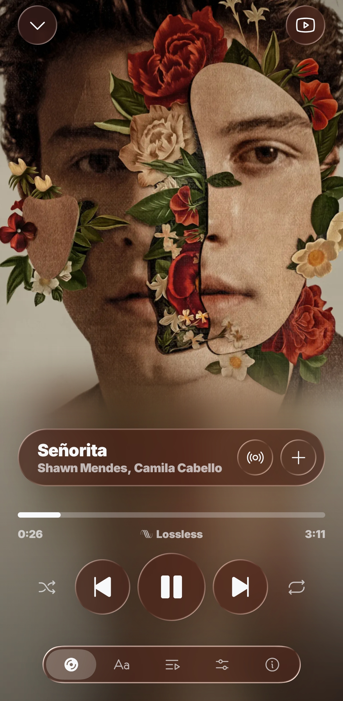
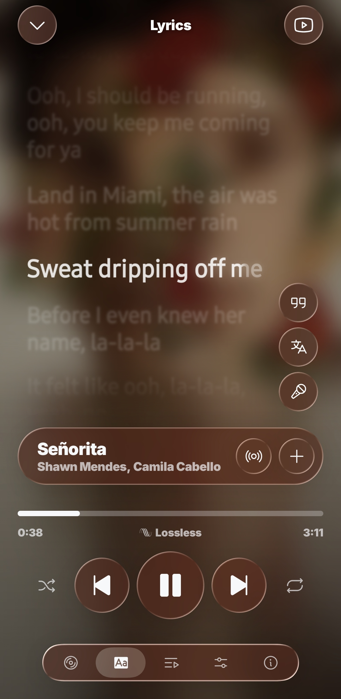
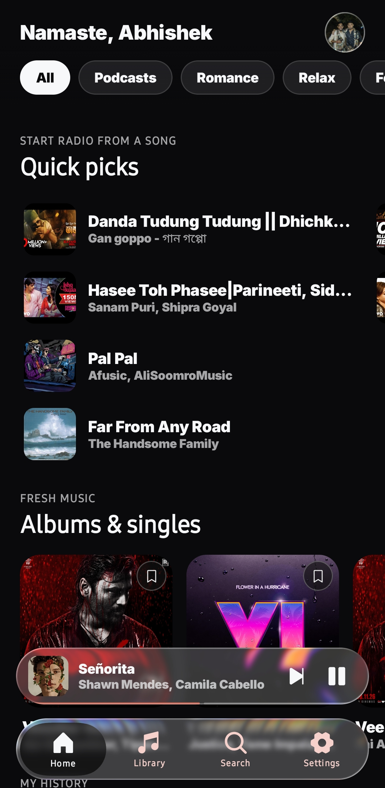
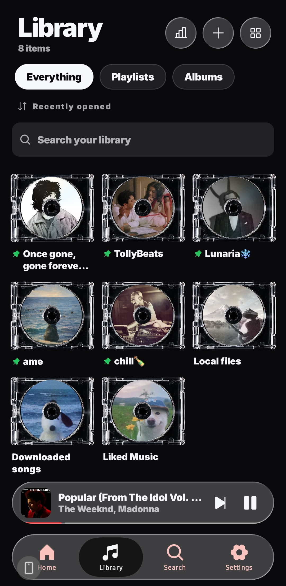
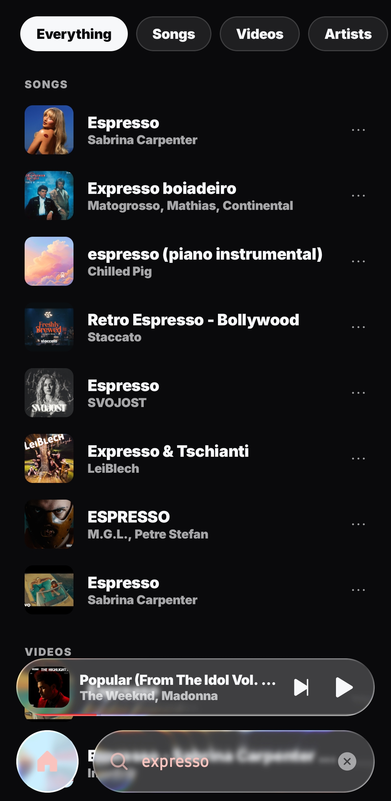
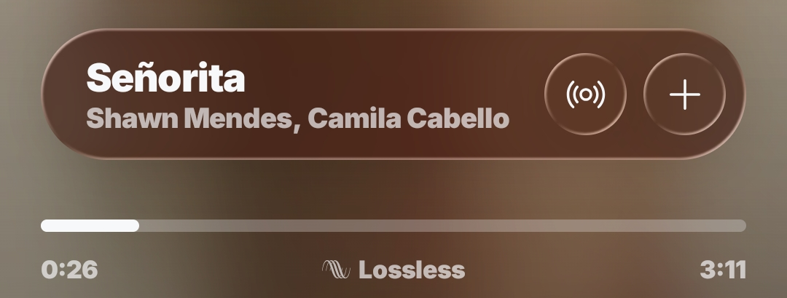
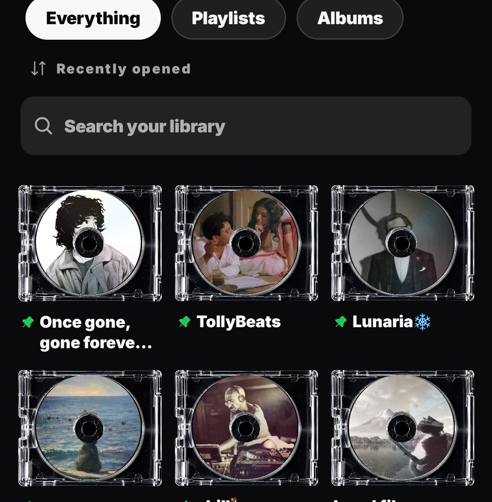
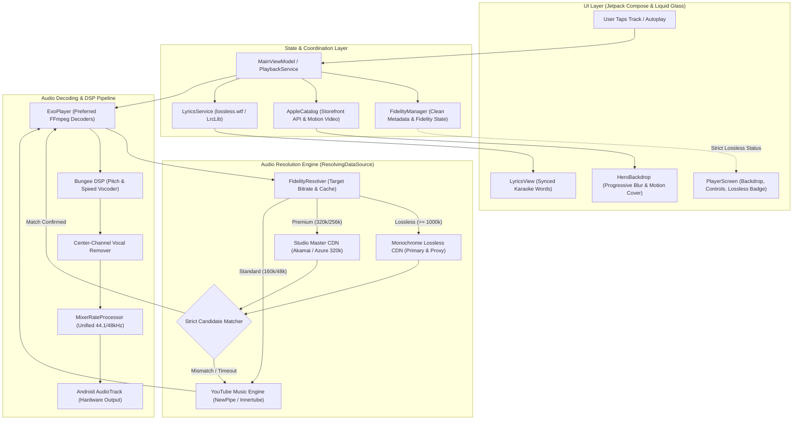

<h1 align="center">Ame</h1>

<p align="center">
  <b>The modern, high-fidelity music streaming client for Android.</b><br>
  Bit-Perfect 24-bit Lossless FLAC · Apple Music motion covers · Live synced lyrics · Pure Liquid Glass.
</p>

<p align="center">
  <a href="https://github.com/AbhishekS04/ame/releases/latest"></a>
  <a href="https://github.com/AbhishekS04/ame/releases"></a>
  
  
  <a href="LICENSE"></a>
</p>

<p align="center">
  <a href="#download"><b>Download</b></a> ·
  <a href="#showcase"><b>Showcase</b></a> ·
  <a href="#features"><b>Features</b></a> ·
  <a href="#audio-fidelity--lossless"><b>Lossless Engine</b></a> ·
  <a href="#architecture"><b>Architecture</b></a> ·
  <a href="#evolution"><b>What Changed</b></a> ·
  <a href="#first-launch"><b>First launch</b></a> ·
  <a href="#faq"><b>FAQ</b></a> ·
  <a href="docs/DEVELOPMENT.md"><b>Building</b></a>
</p>

---

## Showcase

<div align="center">

| **Now Playing (Lossless)** | **Live Synced Lyrics** | **Dynamic Home** |
| :---: | :---: | :---: |
|  |  |  |

<br>

| **CD Jewel Library** | **Universal Search** |
| :---: | :---: |
|  |  |

</div>

---

## Features

### <a id="audio-fidelity--lossless"></a>💎 Bit-Perfect 24-bit Lossless FLAC & Authentic Audio Fidelity

<p align="center">
  
</p>

- **Bit-Perfect 24-bit / 1411+ kbps FLAC**: Stream uncompressed studio master audio through the Monochrome CDN network with multi-mirror Singapore proxy failover.
- **Honest Apple Music Lossless Waveform Badge**: Rendered strictly when an active playback stream is confirmed to decode a genuine uncompressed FLAC bitstream. Zero fake or deceptive labels.
- **Zero-Mismatch Track & Singer Matcher Engine**:
  - Eliminates false song substitutions and mismatched artist swaps.
  - Strict token matching filters out unwanted acoustics, slowed edits, karaoke tracks, or remixes unless explicitly requested.
  - Singer verification validates candidate tracks against the primary artist name and key artist tokens.
  - Tight ±7s duration tolerance ensures pinpoint studio album matching.
  - **100% Authentic Fallback**: If no genuine lossless match exists, Ame seamlessly streams the authentic YouTube Music High Opus (160k) source with standard fidelity. Zero wrong songs, ever.
- **Genuine Stream Quality Switching**:
  - **Automatic**: Dynamic bitrate switching (320 kbps on Wi-Fi, 160 kbps on metered cellular data).
  - **Premium (320 kbps)**: Genuine 320 kbps studio master stream from Akamai/Azure CDNs.
  - **Very High (256 kbps)**: High-bitrate CDN streams.
  - **High (160 kbps)**: YouTube Music standard high quality with 0ms external lookup.
  - **Low (48 kbps)**: Data-saver Opus stream for bandwidth-constrained connections.

---

### 🎨 Apple Music Motion Covers & Balanced Ambient Blur

- **Official Apple Music Motion Covers**: Streams official Apple Music HD looping video motion covers and up to 1600x1600 uncompressed studio master artwork.
- **Smooth Vertical Fade Effect**: The album cover softly dissolves into the ambient backdrop with an 8-step smoothstep curve directly above the song title pill.
- **Progressive Dual-Pass Lighting**: Full-screen ambient lighting dynamically samples dominant tones from the artwork with softened dual-pass Gaussian blurs (`FarBlur` + `NearBlur`).
- **Smooth Poster Reveal**: On track changes, the stage remains softly blurred until the incoming artwork is fully decoded, then smoothly reveals the poster banner with a 550ms ease. Motion covers seamlessly crossfade in once their first video frame is ready, with automatic looping and stall recovery.
- **Clean Artwork Stage**: Zero intrusive text overlays plastered across album art or artist faces.

---

### 💿 CD Jewel Cases & Retro Library

<p align="center">
  
</p>

- **Authentic 3D CD Jewel Cases**: Playlists and albums rendered with realistic acrylic plastic reflections, tray hinges, spine text, and booklet inserts.
- **Unified Library**: Playlists, albums, followed artists, and liked songs from both YouTube Music and Spotify. Create, rename, delete playlists, and pin favorites.
- **Listening Streak & Activity Heatmap**: GitHub-style listening matrix tracking daily listening consistency with live counters: **Current Streak**, **Best Streak**, and **Total Plays**.

---

### 🎤 Live Synced Lyrics

- **Word-by-Word Karaoke Animation**: Real-time fluid word highlighting for supported songs with smooth line-by-line fallback.
- **Multi-Source Pipeline**: Direct queries to `lossless.wtf` first, followed by the `LrcLib` open API.
- **Dynamic Inline Translations**: Sub-line lyric translations rendered in your chosen language right beneath original lines.

---

### 🌐 Universal Search & Dynamic Home

- **Dynamic Time-of-Day Greeting**: Uncropped personalized greetings (*"Good morning"*, *"Namaste"*, *"Good evening"*) with liquid glass profile avatar.
- **High-Contrast Filter Chips**: Inverted contrast chips (*All*, *Music*, *Podcasts*) for instant shelf filtering.
- **Curated Shelves**: Daily Discovery, Quick Picks (4-item snap column carousel), New Releases, and Play Again / Listening History.
- **Universal Search**: Refracting liquid glass search bar with swipe-to-dismiss recent searches and genre exploration.

---

### 🎛️ Audio Effects & Offline Playback

- **DSP Pitch & Speed Shifting**: Independent pitch and tempo scaling powered by Bungee.
- **One-Tap Presets**: Instant "Slowed + Reverb", "Nightcore", and Karaoke voice reduction.
- **Full Offline Downloads**: Download playlists, albums, or individual tracks in high quality. Wi-Fi-only downloading and automatic deduplication across playlists.

---

### 🔌 Two Sources, One App

- **YouTube Music**: Complete catalog and music videos without needing an account; optional Google sign-in to sync your cloud library.
- **Spotify**: Stream your personal library, playlists, and followed artists (requires Spotify Premium).
- **Spotify Connect & Friend Activity**: Control Ame playback from desktop, web, or smart speakers, and see what your friends are listening to in real time.
- **Android Auto**: Full in-car dashboard support with voice search and quick playlist access.

---

## <a id="architecture"></a>🏛️ Architecture & Deep-Dive Engineering

Ame is engineered as a high-performance, modular audio client. While it originated as a fork of [Square](https://github.com/Lelonio/Square), its core media layer, audio resolution pipeline, visual rendering engine, and matching heuristics have been fundamentally re-architected.

### 🌐 System Topology & Node Interconnections

The following diagram illustrates how Ame orchestrates UI events, state coordination, dynamic stream resolution, DSP manipulation, and hardware audio delivery:



---

### 🎵 The Playback Lifecycle: How Music Flows from Tap to Speaker

When you select a song or let autoplay advance the queue, Ame executes a multi-stage pipeline designed for instant responsiveness, bit-perfect fidelity, and zero wrong song substitutions.

#### 1. Clean Metadata Registration (`FidelityManager.kt`)
Standard YouTube Music metadata is heavily polluted with video noise (e.g. `Official Music Video`, `4K Remaster`, `ft. ...`, `Lyric Video`). 
- When a track is queued or played, `FidelityManager.registerTrack()` registers pristine `title`, `artist`, and `durationSec` in a thread-safe global registry.
- This clean representation acts as the ground-truth contract for upstream candidate verification, eliminating fragile regex parsing on the fly.

#### 2. Just-in-Time Resolution via Media3 `ResolvingDataSource` (`YouTubePlayerFactory.kt`)
In conventional music streaming apps, URLs are pre-resolved when building queues. However, YouTube signed stream URLs are cryptographically perishable and expire within hours, causing queued tracks to fail silently when left paused.
- Ame delegates resolution to Media3's `ResolvingDataSource.Resolver`.
- The audio URL is resolved on a background worker thread **the exact millisecond ExoPlayer requests the buffer**, guaranteeing valid tokens and zero queue expiration bugs.

#### 3. Multi-Tier Resolution Ladder & Fallback Hierarchy
When resolving a track (`resolveAnonymously`), Ame executes an intelligent priority ladder based on your selected Audio Quality setting and network type:

```
[Requested Track]
       │
       ▼
┌────────────────────────────────────────────────────────┐
│ Tier 1: Bit-Perfect Lossless FLAC (1411+ kbps)         │
│ • Primary: Monochrome CDN (tracks.monochrome.st)       │
│ • Secondary: Singapore Community Proxy                 │
│ • Network: IPv4-First DNS & RFC 8305 Happy Eyeballs    │
└──────────────────────────────────┬─────────────────────┘
                                   │
                         [Strict Matcher Gate]
                         ├── Title Tokens Match?
                         ├── Negative Modifiers Rejected?
                         ├── Primary Singer Verified?
                         └── Duration within ±7 seconds?
                                   │
              ┌────────────────────┴────────────────────┐
              │ Match Passed                            │ Match Failed / Timeout
              ▼                                         ▼
┌───────────────────────────────┐        ┌───────────────────────────────┐
│ Stream 24-bit Lossless FLAC   │        │ Tier 2: Premium 320 kbps      │
│ • Set isLosslessFlac = true   │        │ • Akamai / Azure CDN Lookup   │
│ • Render [waveform] Lossless  │        │ • Strict Matcher Verification │
└───────────────────────────────┘        └──────────────┬────────────────┘
                                                        │ Match Failed / Disabled
                                                        ▼
                                         ┌───────────────────────────────┐
                                         │ Tier 3: YouTube Music High    │
                                         │ • Direct Opus ~160 kbps       │
                                         │ • Instant 0ms external delay  │
                                         │ • 100% Authentic Fallback     │
                                         └──────────────┬────────────────┘
                                                        │ Data Saver Mode
                                                        ▼
                                         ┌───────────────────────────────┐
                                         │ Tier 4: YouTube Music Low     │
                                         │ • Opus ~48 kbps Data Saver    │
                                         └───────────────────────────────┘
```

#### 4. The Zero-Mismatch Strict Matcher Engine (`FidelityResolver.kt`)
External CDNs index millions of songs with varying tags. Older players blindly pick the first result with a similar duration, causing wrong song swaps (e.g. playing a random pop song instead of an indie track). 
Ame's `isStrictCandidateMatch` enforces four non-negotiable verification gates:
1. **Duration Guardrail**: The candidate's length must match target duration within **±7 seconds**. Differences > 7s are rejected immediately.
2. **Negative Modifier Filtering**: If the target track does not contain modifiers like `remix`, `lofi`, `slowed`, `reverb`, `acoustic`, `instrumental`, `vocals only`, `cover`, `karaoke`, or `live`, any candidate with these tags is discarded.
3. **Significant Token Alignment**: Title words are normalized, stripping punctuation and stop words (`the`, `and`, `with`, `from`). All primary title tokens must be contained within the candidate.
4. **Singer Verification**: Candidate artist arrays are parsed and cross-checked against the target singer. Target artist tokens must match the candidate's verified artists.
5. **Zero Wrong Song Guarantee**: If no external candidate satisfies all four gates, Ame **never** plays an arbitrary track. It falls back to the official YouTube Music High stream with standard fidelity.

#### 5. Audio Decoding & DSP Processing Chain (`YouTubePlayerFactory.kt`, `Bungee`)
Once the bitstream reaches ExoPlayer, it passes through Ame's custom DSP processing chain:
- **Preferred FFmpeg Decoders (`EXTENSION_RENDERER_MODE_PREFER`)**: Platform `MediaCodec` audio decoders often crash with `ubsan: sub-overflow` when switching tracks rapidly. Ame prioritizes bundled native FFmpeg decoders, providing immune stability across all Android devices.
- **Bungee Pitch & Tempo Vocoder**: Unlike Android's stock Sonic resampler—which was built for speech and produces metallic, smeared transients on music—Ame routes audio through a native C++ Bungee DSP vocoder for pristine time-stretching and pitch-shifting.
- **Center-Channel Vocal Canceler**: Implements real-time out-of-phase center vocal attenuation ahead of the vocoder for the built-in Karaoke mode.
- **Mixer Sample-Rate Normalizer (`MixerRateProcessor.kt`)**: Dynamically resamples streams to a unified rate (44.1 kHz / 48 kHz), feeding a clean, continuous PCM stream to Android `AudioTrack`.

---

### 🎨 Artwork, Motion Covers & Ambient Lighting Pipeline

Ame decouples visual presentation from playback so high-definition assets load smoothly without blocking audio:

1. **Apple Music Storefront API (`AppleCatalog.kt`)**:
   - Queries Apple Music's Storefront API with `&extend=editorialArtwork,editorialVideo` to locate official looping motion video covers (`motionDetailTall`, `motionTallVideo3x4`) and 1600x1600 uncompressed studio master artwork.
   - Fallback hierarchy: Apple Music Motion Video → Apple Music 1600x1600 Studio Art → iTunes 1200x1200bb Master Still → YouTube Music 1200x1200 HD Thumbnail.
2. **Stall-Free Motion Cover Video Loop (`MotionCover.kt`)**:
   - Dedicated video-only player handles looping motion covers.
   - Listens for `STATE_ENDED` to seek back to frame 0 instantly, eliminating freeze frames. Auto-recovers on transient network stalls without interfering with audio.
3. **Progressive Ambient Blur (`AmbientArtworkBackground.kt`)**:
   - Real-time dual-pass Gaussian blur (`FarBlur` radius 14 + `NearBlur` radius 8) extracting dominant tones from the artwork.
   - Smooth vertical fade using an 8-step smoothstep curve (`DstIn` blend mode) right above the song title pill, eliminating harsh horizontal split blurs.
4. **550ms Smooth Poster Reveal (`HeroBackdrop.kt`)**:
   - When tracks change, the stage remains softly blurred while the incoming image decodes in memory. Once ready, it smoothly reveals with a 550ms ease, eliminating jarring pops and previous-song lingering.

---

### 🔌 Native Spotify Engine (Rust JNI)

For Spotify Premium users, Ame runs a native Rust engine:
- **Vendored `librespot`**: `librespot-core`, `librespot-playback`, and `librespot-connect` are compiled directly into native `librespot.so` via Cargo.
- **Spirc Protocol**: Acts as an authentic Spotify Connect receiver, allowing remote control from desktop, smart speakers, and other mobile devices.
- **Unified Sink**: Decoded PCM audio from librespot feeds into the same internal `MixerSlot` as ExoPlayer, sharing Bungee audio effects, pitch shifting, and loudness normalization (`ebur128`).

---

### <a id="evolution"></a>🔄 Evolution from Fork: What We Re-Engineered

Ame has evolved significantly beyond the original [Square](https://github.com/Lelonio/Square) open-source repository:

| Architectural Component | Original Square Fork | Modern Ame Engine |
| :--- | :--- | :--- |
| **Audio Resolution** | Standard YouTube Music Opus/AAC & Spotify only | **Multi-tier Hi-Fi Resolution** with up to **24-bit Lossless FLAC** (Monochrome CDN + Singapore proxy). |
| **Track Matching** | Loose duration-only heuristic (caused frequent wrong song swaps) | **Zero-Mismatch Strict Matcher**: token validation, modifier stripping, singer verification, and strict ±7s duration tolerances. |
| **Lossless Indicator** | Unverified / mock badges | **Strict Honesty Guardrail**: Apple Music waveform badge (`~ Lossless`) renders strictly on confirmed uncompressed FLAC streams. |
| **Audio Quality Tiers** | Static cosmetic settings | **Genuine Stream Switching**: Automatic, Premium (320k), Very High (256k), High (160k), and Low (48k). |
| **Motion Covers** | Static square artwork only | **Apple Music Storefront HD Video**: Looping H.264 motion covers with stall recovery and 1600x1600 uncompressed studio masters. |
| **Player Backdrop** | Artificial HSV split blur & dark horizontal stripe | **Progressive Dual-Pass Blur** with 8-step smoothstep vertical fade and 550ms smooth poster reveal. |
| **Decoder Stability** | Platform `MediaCodec` (crashed with `ubsan: sub-overflow`) | **Preferred FFmpeg Decoders** (`EXTENSION_RENDERER_MODE_PREFER`) for crash-free rapid track switching. |
| **Network Resilience** | Default OkHttp (stalled on mobile carrier IPv6) | **IPv4-First DNS** with RFC 8305 Happy Eyeballs (~100ms handshakes across cellular & Wi-Fi). |
| **Library Experience** | Flat 2D album cards | **3D CD Jewel Cases** with realistic acrylic reflections, tray hinges, and spine details. |
| **Listening Analytics** | Basic local play counts | **GitHub-Style Streak Heatmap** with persistent cloud activity and live streak counters. |
| **Audio DSP** | Stock Sonic resampler (metallic distortion) | **Native Bungee C++ Vocoder DSP** for pristine pitch, tempo, and vocal removal. |

---

## Download

Download the APK from the [latest release](https://github.com/AbhishekS04/ame/releases/latest) and install it. Ame requires Android 8.0 or later.

Ame updates itself: it automatically checks for new releases and installs them directly from Settings → About.

<details>
<summary><b>First launch performance tip (speed-profile compilation)</b></summary>

Android optimizes freshly installed apps over time. To compile Ame immediately for maximum smoothness, open the app once, let it run for a few seconds, then execute this command with your phone connected:

```bash
adb shell cmd package compile -m speed-profile -f com.abhishek.ame
```

</details>

---

## First launch

Ame prompts you to choose where your music should come from. You can switch sources at any time in Settings:

- **YouTube Music**: Plays immediately out of the box with no account required. Signing in with Google in Settings is optional to sync your personal library.
- **Spotify**: Requires a Spotify Premium account. Setup walks you through signing in and registering a free client ID in Spotify's developer portal.

---

## FAQ

**Does Lossless consume more data?**  
Yes. Bit-perfect 24-bit FLAC audio consumes approximately 30–50 MB per song. If you are on a metered mobile plan, Ame's *Automatic* setting automatically switches to 160 kbps Opus to conserve data, while reserving Lossless for Wi-Fi.

**Why does the Lossless badge appear on some songs but not others?**  
Ame adheres to strict honesty guardrails. The Apple Music Lossless waveform badge is rendered only when an active stream is verified to decode a true uncompressed FLAC bitstream. If a song is served from YouTube Music (Opus 160k) or CDN 320k, the badge is hidden.

**Ame does not appear in Android Auto.**  
Android Auto only lists apps installed from the Google Play Store by default. Enable "Unknown sources" in Android Auto's developer settings and Ame will appear on your car display.

**Can I use a free Spotify account?**  
No. Spotify only streams to third-party clients via librespot with an active Premium subscription. YouTube Music works with no account at all.

---

## Disclaimer

Ame is not affiliated with, endorsed by, or connected to Spotify or Google. Both services are accessed via private endpoints and reverse-engineered protocols. Ame cannot be published on Google Play and is provided strictly for educational and personal use under the GPL-3.0 license.

---

## Help and feedback

- **Questions**: [Discussions, Q&A](https://github.com/AbhishekS04/ame/discussions/categories/q-a)
- **Feature Requests**: [Discussions, Ideas](https://github.com/AbhishekS04/ame/discussions/categories/ideas)
- **Bug Reports**: [Open an issue](https://github.com/AbhishekS04/ame/issues/new/choose). Attach a crash report from Settings → About → Save a report.

---

## Credits

| Project | Licence | How it is used |
| :--- | :--- | :--- |
| [Square](https://github.com/Lelonio/Square) by Lelonio | GPL-3.0 | The open-source foundation from which Ame is forked. |
| [librespot](https://github.com/librespot-org/librespot) | MIT | The Spotify engine. `librespot-core`, `librespot-playback` and `librespot-connect` are vendored with local patches. |
| [Spotify Web Playback SDK](https://developer.spotify.com/documentation/web-playback-sdk) | Spotify Developer Terms | Playback for accounts Spotify refuses audio keys, through the listener's own developer app. |
| [Metrolist](https://github.com/mostafaalagamy/Metrolist) | GPL-3.0 | Its InnerTube client, vendored as [`innertube/`](innertube/). Powers the signed-in YouTube Music library. |
| [NewPipeExtractor](https://github.com/TeamNewPipe/NewPipeExtractor) | GPL-3.0 | Anonymous YouTube Music search and stream URLs. |
| [Monochrome CDN](https://monochrome.st) | n/a | High-speed bit-perfect 24-bit Lossless FLAC audio streaming. |
| [lossless.wtf](https://lossless.wtf) | n/a | Synced lyrics timed to the word, queried first on both sources. |
| [LrcLib](https://lrclib.net) | n/a | Synced lyrics for YouTube Music sources via open API. |
| [Spicy Lyrics](https://github.com/Spikerko/spicy-lyrics) | AGPL-3.0 | The lyrics animation, ported to Compose by [@donutnotnut](https://github.com/donutnotnut). |
| [Bungee](https://github.com/kupix/bungee) | MPL-2.0 | Time stretching and pitch shifting, fetched at build time. |
| [AndroidLiquidGlass](https://github.com/Kyant0/AndroidLiquidGlass) | Apache-2.0 | The glass material; catalog components are copied with notice. |
| [Phosphor Icons](https://phosphoricons.com) | MIT | Iconography across the application. |
| [ebur128](https://github.com/sdroege/ebur128) | MIT | Loudness normalization for local files. |
| [go-librespot](https://github.com/devgianlu/go-librespot) | GPL-3.0 | Remote sleep timer commands and truncated audio key validation. |

---

## Building from source

Requirements, build steps, signing, architecture overview, and developer notes are documented in [docs/DEVELOPMENT.md](docs/DEVELOPMENT.md).

---

## Licence

GPL-3.0-or-later. See [LICENSE](LICENSE).

The lyrics view ([`LyricsView.kt`](app/src/main/java/dev/lelonio/square/ui/player/LyricsView.kt)) is ported from Spicy Lyrics and remains under AGPL-3.0, combined with the rest as section 13 of both licences permits.
